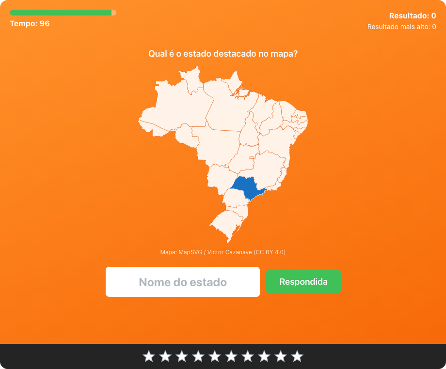

# 100 Segundos

Jogo web de perguntas rápidas: quantas perguntas você consegue responder em 100 segundos? Tem jogos de **matemática** (potenciação e radiciação) e de **geografia do Brasil** (bandeiras, mapa, siglas, capitais e gentílicos).

**Jogue agora: [hundredseconds.vercel.app](https://hundredseconds.vercel.app/)**

> Inspirado no modo **100 segundos** do site [Tabuada de Multiplicar](https://www.tabuadademultiplicar.com.br/100-segundos/), que faz o mesmo desafio com a tabuada. Todo o crédito pela ideia original vai para eles.

<p align="center">
  
</p>

## Jogos

| Grupo | Jogo | O que aparece | O que você digita |
| :--- | :--- | :--- | :--- |
| Matemática | Potenciação | 2⁵ | 32 |
| Matemática | Radiciação | ∛27 | 3 |
| Geografia do Brasil | Bandeiras | A bandeira de um estado | O nome do estado |
| Geografia do Brasil | Estados | O mapa do Brasil com um estado destacado | O nome do estado |
| Geografia do Brasil | Siglas | Minas Gerais | MG |
| Geografia do Brasil | Capitais | Minas Gerais | Belo Horizonte |
| Geografia do Brasil | Gentílicos (estados) | Bahia | baiano |
| Geografia do Brasil | Gentílicos (capitais) | Salvador | soteropolitano |
| História do Brasil | Governantes | 1930 a 1945 | Getúlio Vargas |

## Como funciona

- Uma contagem regressiva (3, 2, 1) com sinal sonoro, depois **100 segundos** para responder o máximo possível. A resposta é enviada com `Enter`.
- Cada acerto vale 1 ponto, e **a cada 10 acertos você ganha uma estrela** (com um "plim"), até 10 estrelas. Um beep avisa quando faltam 10 segundos.
- **Duas tentativas por pergunta (todos os jogos):** no primeiro erro a caixa fica vermelha e você tenta de novo; no segundo, a resposta certa aparece (por 1 segundo na matemática e 1,5 segundo na geografia e na história) e o tempo continua correndo.
- **Matemática:** a dificuldade sobe conforme você acerta.
- **Geografia:** os 27 estados (26 + DF) aparecem sem repetir até todos saírem. Acentos, maiúsculas e espaços extras são ignorados ("sao paulo" vale "São Paulo"), e nos gentílicos também valem o feminino, a forma sem hífen e as formas alternativas oficiais.
- **História:** quem governou o Brasil em cada período, de Dom Pedro I até hoje (regências, juntas provisórias e presidentes), além dos presidentes eleitos que não tomaram posse. Nomes curtos e apelidos também valem ("Vargas", "JK", "Jango", "FHC", "Pedro 2").
- Sem conta, o recorde fica salvo no navegador e você pode publicar o resultado no ranking com um nome. Com conta, os resultados vão para o servidor. Há rankings separados por jogo, do dia, da semana e do ano.

## Telas

| Partida de potenciação | Bandeiras |
| :---: | :---: |
|  |  |
| **Estados no mapa** | **Resposta revelada após um erro** |
|  |  |
| **Resultado** | **No celular** |
|  |   |

## Tecnologias

- **Frontend:** React + TypeScript (Vite) e Mantine — `web_app/`
- **Backend:** Java 25 + Spring Boot 4 (Clean Architecture, JWT) — `api/`
- **Banco:** PostgreSQL 16 (migrations com Flyway)
- **Especificação completa:** [`requirements_specification_100_seconds_game.md`](requirements_specification_100_seconds_game.md)

## Rodando com Docker (tudo junto)

```bash
cp .env.example .env          # ajuste as senhas e gere um JWT_SECRET (openssl rand -base64 48)
docker compose up --build -d
```

Acesse **http://localhost:8088** (porta configurável em `WEB_HOST_PORT`).

| Serviço | Descrição | Porta no host |
| :--- | :--- | :--- |
| `web_app` | Nginx servindo o React e encaminhando `/api` para a API | `8088` |
| `api` | Spring Boot (não exposto; acessado via Nginx) | – |
| `db` | PostgreSQL | `5433` |

Para parar: `docker compose down` (os dados ficam no volume `db_data`; use `down -v` para apagá-los).

## Desenvolvimento local

```bash
docker compose up -d db                 # só o banco
cd api && ./mvnw spring-boot:run        # API na porta SERVER_PORT do .env
cd web_app && npm install && npm run dev  # http://localhost:5173 (proxy de /api para a API)
```

## Deploy

A versão publicada usa **Vercel** (frontend), **Render** (API, pelo `api/Dockerfile`) e **Neon** (PostgreSQL). As migrations do Flyway rodam sozinhas quando a API sobe.

| Onde | Variável | Valor |
| :--- | :--- | :--- |
| Render | `DATABASE_URL` | `jdbc:postgresql://<host>/<banco>?sslmode=require` (sem usuário e senha na URL) |
| Render | `DATABASE_USERNAME` / `DATABASE_PASSWORD` | Credenciais do Neon |
| Render | `JWT_SECRET` | Pelo menos 32 bytes (`openssl rand -base64 48`) |
| Render | `CORS_ALLOWED_ORIGINS` | URL do frontend, sem `/` no final |
| Render | `PORT` | `8080` |
| Vercel | `VITE_API_BASE_URL` | URL da API, sem `/` no final (entra no build) |

Health check: `GET /actuator/health/liveness` (não consulta o banco) e `/actuator/health/readiness`.

## Testes

| Comando | O que testa |
| :--- | :--- |
| `cd api && ./mvnw test` | JUnit 5 + Mockito (domínio e casos de uso) e integração com PostgreSQL via Testcontainers (requer Docker) |
| `cd web_app && npm test` | Vitest + Testing Library (domínio do jogo, componentes e integração com a API simulada) |
| `cd web_app && npm run test:e2e` | Playwright de ponta a ponta (desktop e celular) contra a stack do Docker em `http://localhost:8088`, incluindo uma partida de cada jogo de geografia e história salva no servidor |

Na primeira vez, instale o navegador do Playwright com `npx playwright install chromium`.
Para rodar o E2E contra o servidor de desenvolvimento: `E2E_BASE_URL=http://localhost:5173 npm run test:e2e`.

## Convenções

Código, nomes de arquivos e comentários em inglês; apenas a documentação (`.md`) e os textos da interface em português.

## Créditos

- **Ideia do jogo:** modo [100 segundos](https://www.tabuadademultiplicar.com.br/100-segundos/) do site Tabuada de Multiplicar.
- **Bandeiras dos estados:** imagens obtidas no blog [Missões Nacionais](https://missoesnacionais.org.br/blog/bandeiras-do-brasil-e-dos-estados/). A do Piauí veio do portal da [Receita Federal](https://www.gov.br/receitafederal/pt-br/acesso-a-informacao/acoes-e-programas/cidadania-fiscal/naf/nucleos/arquivos-e-imagens/piaui.png/image_view_fullscreen). Todas foram convertidas para WebP.
- **Mapa do Brasil:** [`@svg-maps/brazil`](https://github.com/VictorCazanave/svg-maps/tree/master/packages/brazil), de Victor Cazanave, baseado no mapa do [MapSVG](https://mapsvg.com/maps/brazil), sob a licença [CC BY 4.0](https://creativecommons.org/licenses/by/4.0/).
